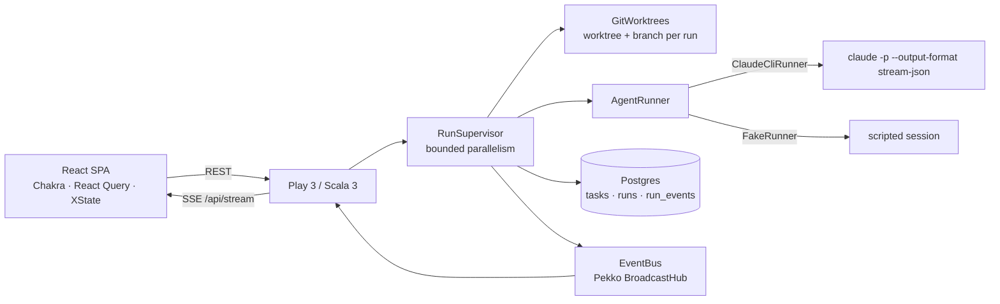

# Agent Workbench

[](https://github.com/danilink/agent-workbench/actions/workflows/ci.yml)

Dispatch one coding task to several Claude Code sessions in parallel, watch them work live, compare their diffs, and keep the best one.

Each attempt runs headless (`claude -p --output-format stream-json`) in its **own git worktree and branch**, so agents never step on each other and every result is an ordinary branch you can review, merge or throw away.

> Status: M1 (core loop) — see [docs/PLAN.md](docs/PLAN.md).

## Why

Running several agent sessions at once is where the leverage is, and also where it gets messy: terminals everywhere, no record of what each session did or cost, and no clean way to compare two solutions to the same problem. This is the small internal tool I wanted for that.

## Architecture



A **task** is a prompt against an allow-listed repo at a pinned commit. It fans out into N **runs**. A run goes `Queued → Preparing → Running → Succeeded | Failed | Cancelled`, then gets reviewed: **Accept** keeps the branch and frees the worktree, **Discard** deletes both.

| Path | What lives there |
| --- | --- |
| `backend/app/workbench/agent` | `AgentRunner` seam, Claude CLI runner, stream-json parser (pure, unit-tested), fake runner |
| `backend/app/workbench/runs` | `RunSupervisor`: lifecycle, concurrency, cancellation, review |
| `backend/app/workbench/git` | Worktree create / diff / remove |
| `backend/app/workbench/store` | Plain JDBC repository |
| `backend/conf/evolutions` | Schema |
| `frontend/src` | SPA; `api/stream.ts` folds SSE pushes into the React Query cache |
| `docs/adr` | Why things are the way they are |
| `.claude/` | How agents are expected to work on this repo (skills, hooks, reviewer subagent) |

## Run it

Prerequisites: JDK 21, sbt, Node 20+, Docker (for Postgres), and Claude Code logged in.

```bash
docker compose up -d                                   # Postgres on :5432

cd backend
WORKBENCH_REPOS=/abs/path/to/some/repo sbt run         # API on :9000 (evolutions auto-apply)
# WORKBENCH_RUNNER=fake ...                            # replay a scripted session, no tokens spent

cd ../frontend && npm install && npm run dev           # UI on :5173
```

Only repositories listed in `WORKBENCH_REPOS` (comma-separated) or `workbench.repos` can be targeted. Agent permissions, turn and budget caps are in `backend/conf/application.conf` under `workbench.claude`.

## How this repo is built

This project is built mostly by agents, steered by me, and the repo is shaped for that:

- **`CLAUDE.md`** is the operating manual: commands, invariants, where things go, what not to touch.
- **Skills** in `.claude/skills/` encode the two most common changes (new endpoint, new evolution) so sessions do them the same way every time.
- **A hook** type-checks the frontend after every edit an agent makes there, so mistakes surface in the same turn.
- **A reviewer subagent** (`.claude/agents/scala-reviewer.md`) checks backend changes against the ADRs before I look.
- **Seams for testability**: the stream-json parser is pure, and `AgentRunner` has a fake, so most behaviour can be verified without spending tokens.

## Roadmap

See [docs/PLAN.md](docs/PLAN.md). Next up: Redis pub/sub so the event bus works across nodes, an "ask the agents to review each other" step, Storybook for the run timeline, Docker image.

## License

[MIT](LICENSE)
